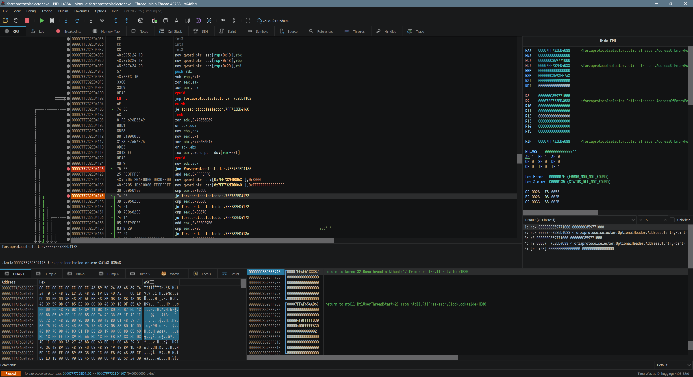

# 🔖 x64dbg-VS-Darker

A Visual Studio 2026 **dark** theme for [x64dbg](https://github.com/x64dbg/x64dbg),
built around the official Visual Studio Image Library.

Originally based on the work by [ThunderCls](https://github.com/ThunderCls/x64dbg_vs_dark).

## Screenshots

| | |
| --- | --- |
| [Memory map](docs/screenshots/memory-map.png) | [Symbols](docs/screenshots/symbols.png) |
| [Breakpoints](docs/screenshots/breakpoints.png) | [Binary edit](docs/screenshots/binary-edit.png) |
| [Preferences](docs/screenshots/preferences.png) | |

## Installation

1. Copy the `VSDarker` folder to `%x64dbg_Path%/themes/`
2. Run the debugger and pick the theme from `Options -> Theme`

## Features

**Visual Studio Image Library icons.** 303 of x64dbg's 322 icon names are served
from the official Visual Studio 2026 Image Library. Each SVG is recoloured for a
dark background the way VS itself does it.

**HiDPI icons.** Two theme directories, `icons/` at 16px and `icons32/` at
32px, both declared in `index.theme`, so Qt picks the right size instead of
upscaling a 16px bitmap at 200% DPI. The widget chrome in `rc/` ships at 1x
and 2x.

**Safe icon fallback.** x64dbg resolves icons through `QIcon::fromTheme()` and
`index.theme` declares `Inherits=Dark`, so any name not overridden falls back
to the built-in icon cleanly.

**Two-level surfaces**, mirroring how VS separates the editor from its tool
windows:

| Surface | Colour | Used by |
| --- | --- | --- |
| Editor | `#121314` | disassembly, stack, registers, graph, sidebar |
| Tool window | `#191A1B` | dump, tables, panels, toolbars, menu bar, status bar |
| Floating | `#202122` | menus, popups, tooltips |

Separators `#2A2B2C`, control borders `#333536`, accent `#297AA0`, focus
`#3994BC`, links `#48A0C7`, selection `#276782`, foreground `#BFBFBF` over
`#8C8C8C` dim and `#555555` disabled.

## Notes

* The Visual Studio Image Library is redistributed by Microsoft under its own
  licence, see [Visual Studio Image Library EULA](docs/vs-image-library-eula.rtf)
